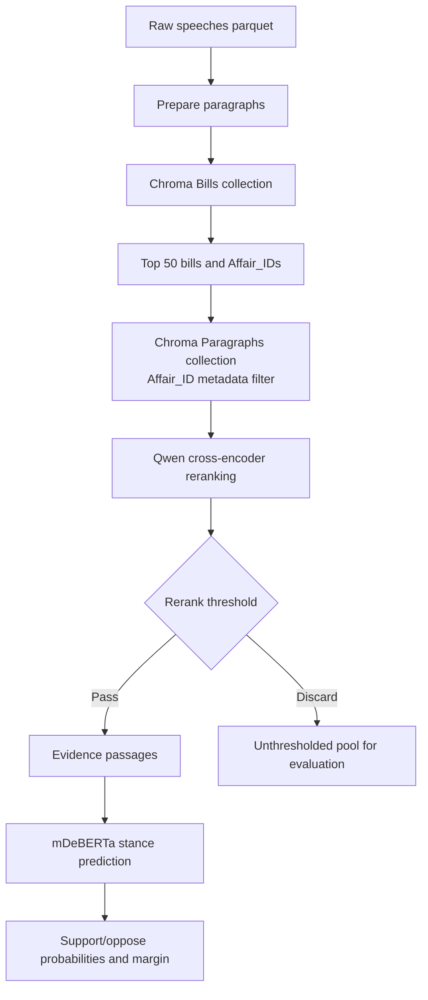

# MappingDemocraSci

MappingDemocraSci is a two-stage retrieval and stance-detection pipeline for Swiss parliamentary speech. It retrieves bills with high recall, narrows their paragraphs with a cross-encoder, and applies a fine-tuned mDeBERTa stance classifier to the retained evidence.

## Pipeline overview



Harrier (`microsoft/harrier-oss-v1-0.6b`) creates normalized embeddings for both
collections. Bill documents combine German and French titles with statutory text
from `data/bill_metadata_cache.json`; ideological summaries are not embedded.
Paragraphs remain linked to bills through their `Affair_ID` metadata.

## RunAI

Image is based on `nvcr.io/nvidia/pytorch:25.06-py3` with 1 GPU with 20% of its memory (~16GB of A100).

Run the following command to submit a job:

```bash
runai workspace submit <JOB_NAME> \
-i nvcr.io/nvidia/pytorch:25.06-py3 \
--gpu-request-type portion \
--gpu-portion-request 0.20 \
--gpu-devices-request 1
```

To expose the SSH port and connect to the workspace, run:

```bash
kubectl port-forward "pod/<JOB_NAME>-0-0" 2222:22 -n "runai-politperformance-<YOUR_USER>"
```

then connect in interactive mode with:

```bash
ssh root@localhost -p 2222
```

## Setup and data

The project requires Python 3.12 or newer. Install dependencies with:

```bash
uv sync
```

The Chroma ingestion command consumes `data/speeches_with_text.parquet`. Generate it first by reassembling the original dataset from the 3 parts:

```bash
# We first concatenate the 3 parts into a single .gz file.
cat data/speeches_with_text.gz.part_* > data/speeches_with_text.gz

# Then decompress the .gz file into a .parquet file.
gunzip < "data/speeches_with_text.gz" > "data/speeches_with_text.parquet"
```

To ingest all eligible paragraphs and bills into Chroma, run:

```bash
python chroma.py --recreate
```

After ingestion, `main.py` reads only the persistent Chroma collections; it does
not load the parquet at query time. If the collections use a non-default path,
pass it with `--chroma-db-path`.

## Detailed pipeline

1. `prepare_paragraphs()` filters the raw parquet to Motion and Parliamentary Initiative rows, cleans text, and removes empty or voting-marker paragraphs.
2. `chroma.py` builds two persistent collections: one bill record per `Affair_ID` and one paragraph record per `speech_id:paragraph_id`.
3. Bill documents embed German and French titles plus statutory text from `data/bill_metadata_cache.json`; ideological summaries are excluded.
4. `score_bills()` queries the Chroma bill collection with Harrier embeddings and keeps `N_TOP_BILLS` (50).
5. `score_paragraphs()` queries the paragraph collection with an `Affair_ID` metadata filter, then reranks the dense pool with `Qwen/Qwen3-Reranker-0.6B`. By default Qwen sees paragraph text only; `--contextual-reranking` also prepends the bill title in the paragraph's language.
6. `score_stance()` compares each retained passage with the stance claim using `MatteoFasulo/mdeberta-v3-xstance`.

The ingestion command exposes independent HNSW settings for both collections. `ef_construction` changes require `--recreate`; `ef_search` can be updated on an existing collection:

```bash
python chroma.py \
  --bills-ef-search 100 --bills-ef-construction 200 \
  --paragraphs-ef-search 100 --paragraphs-ef-construction 200
```

`--topic` must be one of the 21 topics in `const.py`. The pipeline retrieves the top 50 bills, uses a paragraph dense pool of 100 by default, and applies the `0.40` rerank threshold from `const.py`. If `--stance-claim` is omitted, the retrieval query is used for stance scoring as well.

## Outputs

Each run writes a new directory under `outputs/` containing:

- `candidate_bills.json`: the top 50 bills retrieved for the query.
- `candidate_passages_before_threshold.json`: the Chroma dense pool ranked by the Qwen cross-encoder before threshold filtering.
- `candidate_passages.json`: the filtered passages with `rerank_score >= RERANK_THRESHOLD`.
- `stance_predictions.json`: the stance predictions for each passage, including the predicted stance label.
- `manifest.json`: a manifest of the run, including the retrieval query, stance claim, topic, and other parameters.

## Run

The retrieval models are served by a local synchronous FastAPI process. Start it
once and leave it running:

```bash
uv run uvicorn model_service:app --host 127.0.0.1 --port 8000
```

Check that the models and Chroma collections loaded successfully:

```bash
curl http://127.0.0.1:8000/health
```

In a second terminal, run one pipeline job:

```bash
uv run python main.py \
  --run-name free-trade-us \
  --topic "International Affairs" \
  --retrieval-query "Should Switzerland strive for a free-trade agreement with the US?"
```

`main.py` calls the service at `http://127.0.0.1:8000` by default. Use
`--service-url` to connect to another local service address. The model service
must remain running while `main.py` or `runner.py` executes.

Optional controls include `--paragraph-dense-pool`, `--batch-size`,
`--contextual-reranking`, and `--service-url`. If the Chroma database or
collection names differ from the service defaults, configure them in
`model_service.py` before starting the service.

### Run all policy solutions

With the model service still running, use:

```bash
uv run python runner.py
```

The runner invokes `main.py` sequentially and writes each run's artifacts to
a separate directory under `outputs/`.

## Docker (broken)

**NOTE:** The Dockerfile is currently broken due to an issue with SSH interactive sessions.

The image for RunAI is available on GitHub Container Registry at `ghcr.io/matteofasulo/democrasci-am:latest`.

To pull the image from GitHub Container Registry, run:

```bash
docker pull ghcr.io/matteofasulo/democrasci-am:latest
```

### Development

To create the image needed for the workflow, run:

```bash
docker build --no-cache --pull -f Dockerfile -t ghcr.io/matteofasulo/democrasci-am:latest .
docker push ghcr.io/matteofasulo/democrasci-am:latest
```
