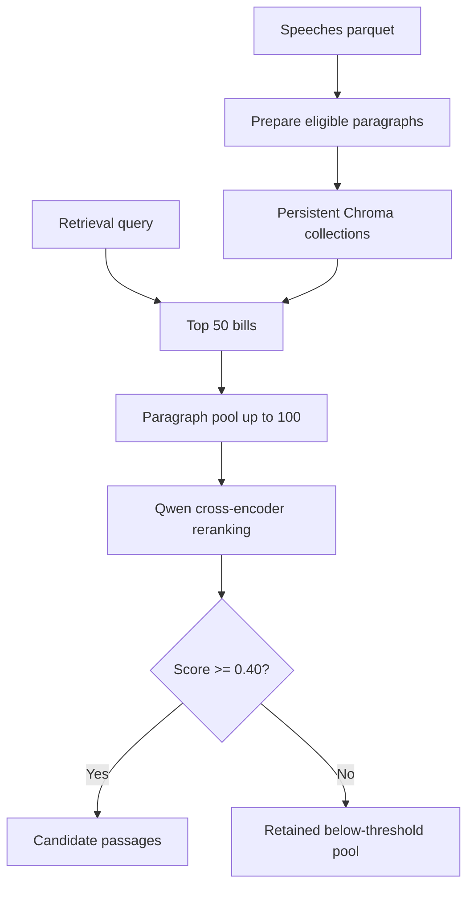

# MappingDemocraSci

MappingDemocraSci is a two-stage retrieval and stance-detection pipeline for Swiss parliamentary speech. It retrieves bills with high recall, narrows their paragraphs with a cross-encoder, and applies a fine-tuned mDeBERTa stance classifier to the retained evidence.

## Pipeline overview

The active pipeline has three stages:

1. **Corpus preparation and indexing** - chroma.py prepares eligible Swiss
   parliamentary speech paragraphs, creates one bill document per Affair_ID,
   and stores bill and paragraph records in persistent Chroma collections.
   Harrier (microsoft/harrier-oss-v1-0.6b) creates normalized embeddings.
2. **Bill retrieval** - the model service embeds each retrieval query and
   retrieves the top 50 bills from the Chroma bills collection.
3. **Paragraph retrieval and reranking** - it retrieves up to 100 paragraphs
   matching those bills through an Affair_ID filter, then ranks them with
   Qwen/Qwen3-Reranker-0.6B. The default threshold is 0.40; both the full
   reranked pool and passages above the threshold are saved for inspection
   and annotation.

The model service loads the embedding function, Chroma collections, and Qwen
reranker once. main.py and runner.py call the service and write run artifacts;
they do not load the retrieval models themselves.



**Current status:** stance detection code exists but is currently disabled in
main.py. The current outputs are retrieval and reranking outputs only.

## RunAI

Image is based on `nvcr.io/nvidia/pytorch:25.06-py3` with 1 GPU with 20% of its memory (~16GB of A100).

<details>

<summary>RunAI CLI instructions</summary>

Run the following command to submit a job:

```bash
runai workspace submit <JOB_NAME> \
-i nvcr.io/nvidia/pytorch:25.06-py3 \
--gpu-request-type portion \
--gpu-portion-request 0.20 \
--gpu-devices-request 1
```

To expose the SSH port and connect to the workspace, run:

```bash
kubectl port-forward "pod/<JOB_NAME>-0-0" 2222:22 -n "runai-politperformance-<YOUR_USER>"
```

then connect in interactive mode with:

```bash
ssh root@localhost -p 2222
```

</details>

## Setup and data

The project requires Python 3.12 or newer. Install dependencies with:

```bash
uv sync
```

alternatively, use pip:

```bash
pip install --break-system-packages sentence-transformers openai chromadb seaborn plotly fastapi streamlit
```

The Chroma ingestion command consumes `data/speeches_with_text.parquet`. Generate it first by reassembling the original dataset from the 3 parts:

```bash
# We first concatenate the 3 parts into a single .gz file.
cat data/speeches_with_text.gz.part_* > data/speeches_with_text.gz

# Then decompress the .gz file into a .parquet file.
gunzip < "data/speeches_with_text.gz" > "data/speeches_with_text.parquet"
```

## Detailed pipeline

- prepare_paragraphs() filters the raw parquet to Motion and Parliamentary
  Initiative rows, cleans text, and removes empty or voting-marker paragraphs.
- chroma.py builds one bill record per Affair_ID and one paragraph record per
  speech_id:paragraph_id.
- Bill documents combine German and French titles with statutory text from
  data/bill_metadata_cache.json; ideological summaries are excluded.
- score_bills() retrieves N_TOP_BILLS (50) bills using Harrier embeddings.
- score_paragraphs() retrieves a paragraph pool with an Affair_ID metadata
  filter and reranks it with Qwen. contextual-reranking adds the
  language-matched bill title to the reranking document.
- RERANK_THRESHOLD is 0.40 in const.py. The unthresholded pool is saved even
  when passages fall below this threshold.

The ingestion command exposes independent HNSW settings for both collections.
ef_construction changes require --recreate; ef_search can be updated on an
existing collection:

```bash
python chroma.py \
  --bills-ef-search 100 --bills-ef-construction 200 \
  --paragraphs-ef-search 100 --paragraphs-ef-construction 200
```

## Outputs

<details>
<summary>View output files</summary>

The consolidated collaborator package is outputs/annotation_candidates_above_0.40.json. It contains one record per unique passage with rerank_score >= 0.40. When a passage appeared for multiple queries, the first occurrence is kept. The collaborator-facing records retain stable provenance fields (source run/file, Chroma ID, Affair_ID, speech/paragraph IDs, query, stance claim, topic, language, and text) so annotations can be joined back to the original outputs. Model scores and ranking fields are omitted.

Each run writes a new directory under outputs/ containing:

- candidate_bills.json: the top bills retrieved for the query.
- candidate_passages_before_threshold.json: the reranked paragraph pool,
  including passages below 0.40.
- candidate_passages.json: passages with rerank_score >= 0.40.
- manifest.json: the query, topic, model configuration, and record counts.

stance_predictions.json is not currently generated because stance detection is
disabled in main.py.

</details>

## Run

Run the pipeline in two terminals. The model service must be started before
main.py or runner.py.

### 1. Prepare the database once

If the parquet file does not exist, reassemble it:

```bash
cat data/speeches_with_text.gz.part_* > data/speeches_with_text.gz
gunzip < data/speeches_with_text.gz > data/speeches_with_text.parquet
```

Build the persistent Chroma collections:

```bash
python chroma.py --recreate
```

Repeat this step whenever the indexed corpus changes.

### 2. Terminal 1: start the model service

From the repository root:

```bash
uvicorn model_service:app --host 127.0.0.1 --port 8000
```

Wait for the models to finish loading, then check:

```bash
curl http://127.0.0.1:8000/health
```

A successful response contains status ok and the bill and paragraph counts.

### 3. Terminal 2: run one query

From the repository root:

```bash
python main.py \
  --run-name free-trade-us \
  --topic "International Affairs" \
  --retrieval-query "Should Switzerland strive for a free-trade agreement with the US?"
```

main.py uses http://127.0.0.1:8000 by default. To use another service
address, add --service-url http://HOST:PORT.

### Run all policy solutions

Keep Terminal 1 running, then in Terminal 2 execute:

```bash
python runner.py
```

The runner calls main.py sequentially and writes one artifact directory per
policy solution under outputs/.

## Docker (broken)

**NOTE:** The Dockerfile is currently broken due to an issue with SSH interactive sessions.

The image for RunAI is available on GitHub Container Registry at `ghcr.io/matteofasulo/democrasci-am:latest`.

To pull the image from GitHub Container Registry, run:

```bash
docker pull ghcr.io/matteofasulo/democrasci-am:latest
```

### Development

To create the image needed for the workflow, run:

```bash
docker build --no-cache --pull -f Dockerfile -t ghcr.io/matteofasulo/democrasci-am:latest .
docker push ghcr.io/matteofasulo/democrasci-am:latest
```
