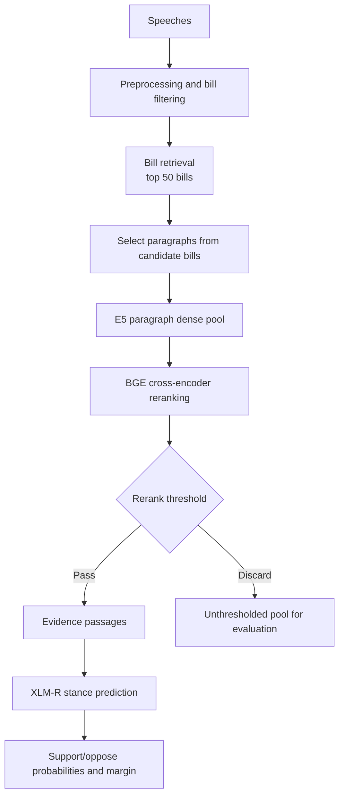

# MappingDemocraSci

MappingDemocraSci is a two-stage retrieval and stance-detection pipeline for Swiss parliamentary speech. It retrieves bills with high recall, narrows their paragraphs with a cross-encoder, and applies a fine-tuned XLM-RoBERTa stance classifier to the retained evidence.

## Pipeline overview



## Embedding and Scoring

Let $(q)$ be the retrieval query. For each bill $(b_i)$, the searchable text is

$$
x_i = \text{Bill-Title-DE}_i \,:: \text{Statutory-text}_i,
$$

where $(::)$ denotes concatenation.

The encoder produces normalized vectors by embedding the query and each bill text:

$$
\mathbf{q} = E(\text{query: }q), \qquad
\mathbf{b}_i = E(\text{passage: }x_i),
$$

and bill similarity is their dot product, equivalent to cosine similarity after
normalization:

$$
s_{\mathrm{bill}}(q,b_i) = \mathbf{q}^{\top}\mathbf{b}_i.
$$

>Note: the `query` and `passage` prefixes are used to distinguish the two types of text in the multilingual E5 encoder as indicated in the model card.

The candidate bill set is the top $(K=50)$ bills ranked by
this score:

$$
\mathcal{B}_K(q) = \text{TopK}_{b_i}\ s_{\mathrm{bill}}(q,b_i).
$$

Let $(p_j)$ be a speech paragraph linked to one of the selected bills. Paragraph
embeddings are scored in the same way:

$$
\mathbf{p}_j = E(\text{passage: }p_j), \qquad
s_{\mathrm{dense}}(q,p_j) = \mathbf{q}^{\top}\mathbf{p}_j.
$$

The dense paragraph pool contains the top $(M=100)$ paragraphs by $(s_{\mathrm{dense}})$. These paragraphs are then scored by the BGE cross-encoder $(R)$:

$$
s_{\mathrm{rerank}}(q,p_j) = \sigma(R(q,p_j)).
$$

whose output is bounded in $(0,1)$ by the sigmoid $(\sigma)$.
>Note: the original output of the BGE cross-encoder is unbounded, but we apply a sigmoid to produce a reranking score in $(0,1)$ as to later threshold the evidence pool.

The final evidence set passed to stance detection is

$$
\mathcal{P}_{\tau}(q) = \{\ p_j \in \mathcal{P}_M(q) : s_{\mathrm{rerank}}(q,p_j) \geq \tau \}\,
$$

where $(\tau=0.4)$ is the reranking threshold. The complete unthresholded reranked pool is retained for evaluating the precision–recall tradeoff of $\tau$.

>Info: Bill retrieval is the recall stage: bill search text combines the German bill title and statutory text.

>Info: Paragraph reranking is the precision stage: it selects passages that address the query more closely before stance scoring. The unthresholded pool is always saved for threshold evaluation.

## RunAI

Image is based on `nvcr.io/nvidia/pytorch:25.06-py3` with 1 GPU with 20% of its memory (~16GB of A100).

Run the following command to submit a job:

```bash
runai workspace submit <JOB_NAME> \
-i nvcr.io/nvidia/pytorch:25.06-py3 \
--gpu-request-type portion \
--gpu-portion-request 0.20 \
--gpu-devices-request 1
```

To expose the SSH port and connect to the workspace, run:

```bash
kubectl port-forward "pod/<JOB_NAME>-0-0" 2222:22 -n "runai-politperformance-<YOUR_USER>"
```

then connect in interactive mode with:

```bash
ssh root@localhost -p 2222
```

## Setup and data

The project requires Python 3.12 or newer. Install dependencies with:

```bash
pip install --break-system-packages sentence-transformers streamlit openai
```

The CLI consumes `data/speeches_with_text.parquet` which must be generated beforehand. To reassemble the original dataset from the 3 parts, run:

```bash
# We first concatenate the 3 parts into a single .gz file.
cat data/speeches_with_text.gz.part_* > data/speeches_with_text.gz

# Then decompress the .gz file into a .parquet file.
gunzip < "data/speeches_with_text.gz" > "data/speeches_with_text.parquet"
```

## Detailed pipeline

1. `df_preprocessing()` filters bill-related rows, cleans text, and attaches cached OpenParldata metadata by `Affair_ID`.
2. `df_bill_metadata()` aggregates one record per bill. `bill_search_text` contains `bill_title_de` plus `statutory_text`.
3. `score_bills()` embeds the query and bill text with `intfloat/multilingual-e5-large`, ranks by cosine similarity, and keeps `N_TOP_BILLS` (50).
4. `select_target_speeches()` restricts the paragraph corpus to the selected bills. E5 similarity forms the configurable dense pool.
5. `score_paragraphs()` reranks that pool with `BAAI/bge-reranker-v2-m3`, saves all scores, and filters on `RERANK_THRESHOLD` (currently `0.4`).
6. `score_stance()` compares each retained passage with the stance claim using `MatteoFasulo/xlm-roberta-xstance`. It outputs support/oppose probabilities and their margin; binary uncertainty is not a trained neutral class.

`--topic` must be one of the 21 topics in `const.py`. If `--stance-claim` is omitted, the retrieval query is used for stance scoring as well.

## Outputs

Each run writes a new directory under `outputs/` containing:

- `candidate_bills.json`: the top 50 bills retrieved for the query.
- `candidate_passages_before_threshold.json`: the full dense pool of passages ranked by the BGE cross-encoder before filtering to inspect the reranker score distribution.
- `candidate_passages.json`: the filtered passages with `rerank_score >= RERANK_THRESHOLD`.
- `stance_predictions.json`: the stance predictions for each passage, including the predicted stance label.
- `manifest.json`: a manifest of the run, including the retrieval query, stance claim, topic, and other parameters.

## Run

```bash
python main.py \
  --run-name free-trade-us \
  --topic "International Affairs" \
  --retrieval-query "Should Switzerland strive for a free-trade agreement with the US?"
```

Optional controls include `--paragraph-dense-pool` and `--batch-size`.

## Dashboard

The same workflow is available through Streamlit:

```bash
streamlit run dashboard.py
```

Enter a retrieval query, select a topic, and optionally provide a separate stance claim. The dashboard writes the same JSON artifacts and manifest as the CLI under the configured output directory.

## Human evaluation

TBD via streamlit dashboard.

## Docker (broken)

**NOTE:** The Dockerfile is currently broken due to an issue with SSH interactive sessions.

The image for RunAI is available on GitHub Container Registry at `ghcr.io/matteofasulo/democrasci-am:latest`.

To pull the image from GitHub Container Registry, run:

```bash
docker pull ghcr.io/matteofasulo/democrasci-am:latest
```

### Development

To create the image needed for the workflow, run:

```bash
docker build --no-cache --pull -f Dockerfile -t ghcr.io/matteofasulo/democrasci-am:latest .
docker push ghcr.io/matteofasulo/democrasci-am:latest
```
